<div align="center">

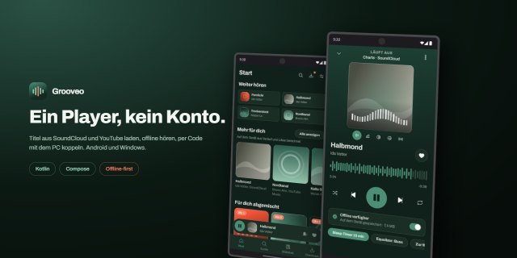

<p></p>

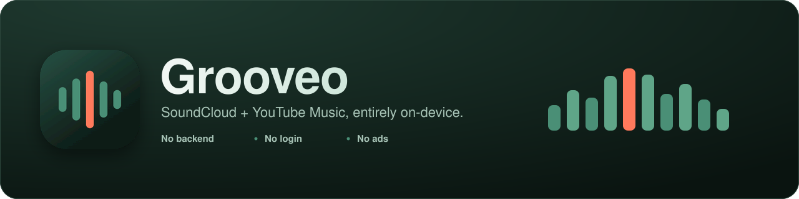

<p></p>

[](https://github.com/lcbs181/grooveo/actions/workflows/ci.yml)
[](https://github.com/lcbs181/grooveo/releases)
[](LICENSE)
[](gradle/libs.versions.toml)
[](app/build.gradle.kts)
[](CONTRIBUTING.md)

**No backend. No account. No login screen.**
Search, stream, download, like, and organize — all resolved and stored directly on the phone.

</div>

<br>

## Contents

- [Features](#features)
- [Screenshots](#screenshots)
- [Dawn Music](#dawn-music)
- [Architecture](#architecture)
- [Building](#building)
- [Optional backend link](#optional-backend-link)
- [Privacy](#privacy)
- [Known limitations](#known-limitations)
- [Contributing](#contributing)
- [Security](#security)
- [License](#license)

## Features

| | |
|---|---|
| **Search** | Across SoundCloud and YouTube Music — tracks, artists, playlists, and albums, per-source or combined. One *Hörspiele & Hörbücher* tab gathers ARD, LibriVox and (if switched on) YouTube series, albums and videos; the empty search offers genre tiles for it and a way into the podcast browser. A pasted YouTube or SoundCloud link opens directly: a video or track plays, a playlist, channel or profile opens its page. |
| **Streaming** | Fully on-device. SoundCloud resolves its own signed CDN URLs (native HLS via Media3); YouTube Music resolves through NewPipeExtractor. No server-side proxy, ever. |
| **Downloads** | Offline playback for both sources — progressive download for YouTube, segment-fetch-and-concatenate for SoundCloud's HLS streams (see [Known limitations](#known-limitations) for the DRM-only exception) — plus a *Datensparmodus* (data-saver) setting that restricts playback to downloaded tracks only. |
| **Likes & playlists** | Stored locally in Room, with reordering, rename, and bulk-download-a-playlist. |
| **Home** | A *Charts* shelf (global SoundCloud/YouTube trending) and a *Für dich* feed computed entirely on-device from local play history and likes — no server-side aggregation. |
| **Artist pages** | Collapsible bio, top/latest track shelves, and a paginated follower list (SoundCloud). Any YouTube channel opens as one (from the *Hörspiele & Hörbücher* tab, or "Zum Künstler" on a YouTube video); a plain channel also offers *Als Folgen* (its uploads as a show) and opens its playlists as shows. |
| **Text for spoken episodes** | The lyrics sheet shows a YouTube video's subtitles in time, and for a LibriVox audiobook the book's text (Project Gutenberg, Projekt Gutenberg-DE, Wikisource) with estimated timing. |
| **Player** | Waveform-style seek bar, shuffle/repeat, a sleep timer (15–90 min presets), a parametric equalizer (up to 16 bands, presets, bass enhancer, limiter, AutoEQ import), and a stream/download switch per track. |
| **Endless queue** | Whatever you start — one track, an album, a playlist, a download — matching tracks from the on-device recommender are appended while the last ones still play, so the queue never runs out (repeat modes excepted). |
| **Gapless** | Tracks run straight into each other; dead air at the end of an upload is detected in the decoded audio and skipped. |
| **Lautstärke-Boost** | Up to +12 dB in front of the limiter: quiet tracks get louder, peaks are caught instead of clipped. |
| **3D-Sound** | In-process convolution reverb with six rooms (Kino, Heimkino, Konzert, Rave, Studio, Kirche) and a *Hall-Anteil* slider (0–200 %); a look-ahead limiter lets it get louder without clipping. |
| **Audio visualizers** | Five real-time, audio-reactive visualizer styles on the Player screen (bars, orb, particle sphere, circular spectrum, and a confetti-spraying pulse mode) — driven by an on-device FFT tapped directly from the decoded audio, not a fake animation. No `RECORD_AUDIO` permission needed; see [Architecture](docs/ARCHITECTURE.md#visualizer). |
| **Home-screen widget** | Jetpack Glance, five size tiers from a 1×2 mini card up to a 3×7 tablet layout — play/pause/skip, now-playing artwork, and an up-next queue at the larger sizes. |
| **Optional update channel** | Point it at the companion backend (see [below](#optional-backend-link)) and the app can check for and install new builds directly, with no Play Store listing. |

## Screenshots

<div align="center">
<table>
<tr>
<td align="center">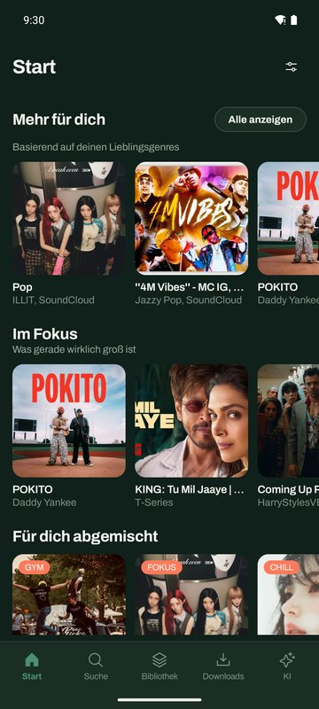<br><sub>Start</sub></td>
<td align="center">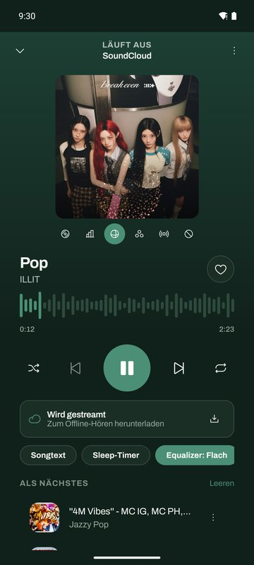<br><sub>Player</sub></td>
<td align="center">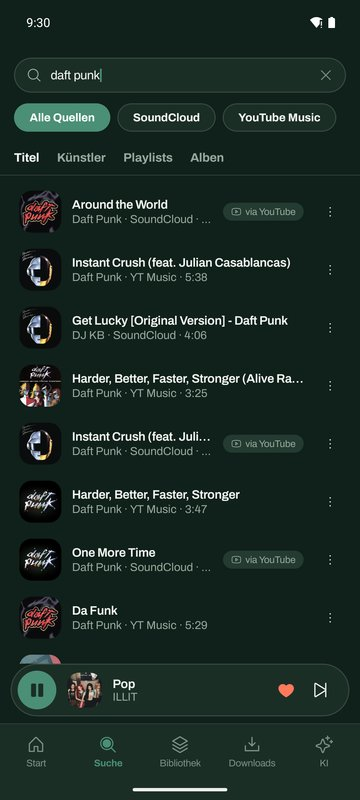<br><sub>Suche</sub></td>
</tr>
<tr>
<td align="center">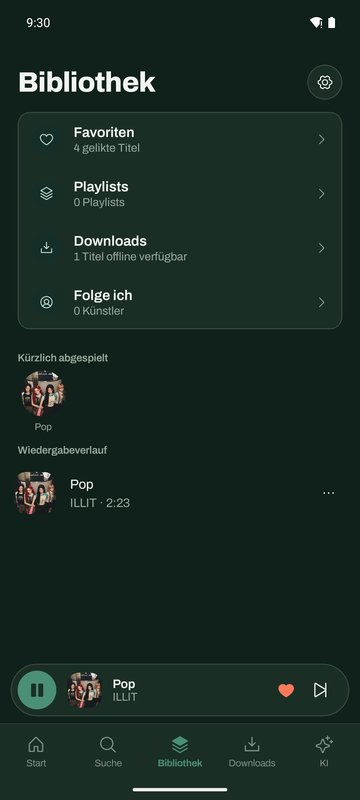<br><sub>Bibliothek</sub></td>
<td align="center">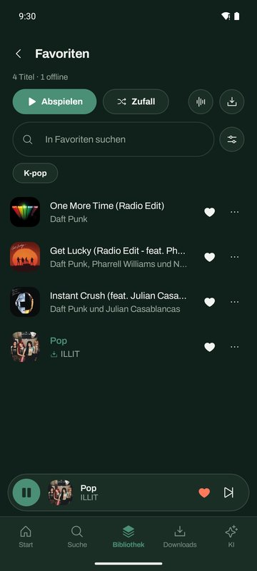<br><sub>Favoriten</sub></td>
<td align="center">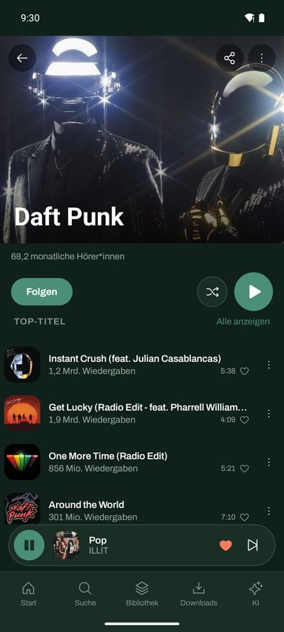<br><sub>Künstler</sub></td>
</tr>
<tr>
<td align="center">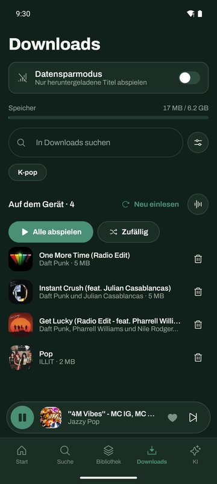<br><sub>Downloads</sub></td>
<td align="center">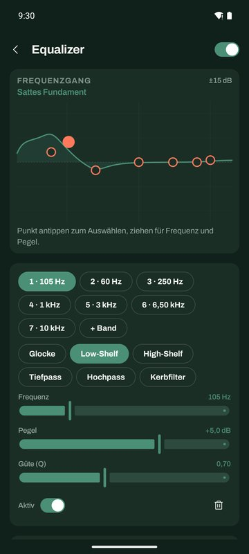<br><sub>Equalizer</sub></td>
<td align="center">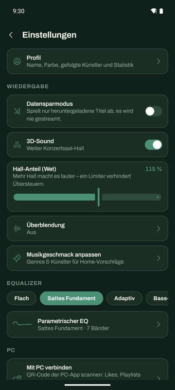<br><sub>Einstellungen</sub></td>
</tr>
</table>

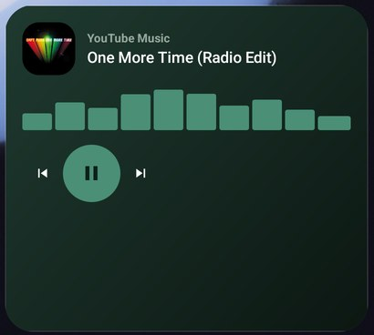<br><sub>Widget</sub>
</div>

## Dawn Music

**Dawn Music** is the second edition built from this repo: the same engine,
for people who just want to listen — no PC, no settings jungle, a familiar
Spotify-style layout.

- **Three tabs**: Start · Suchen · Bibliothek. Downloads are a filter in the
  library instead of a tab of their own.
- **Left out on purpose**: PC sync and live mix, DJ/mix controls, technical
  settings and the AI assistant.
- **Look**: "Sonnenaufgang am Meer" — ocean blue with warm amber first light,
  a dark mode ("Meer vor der Dämmerung", deep navy; Einstellungen › Design:
  System / Hell / Dunkel), translucent "liquid glass" bars and watercolour artwork with a dolphin as
  the logo. For Halloween, Weihnachten, Ostern, Karneval, Silvester and
  Valentinstag the app dresses up to match.
- **Home-screen widget** in the same sunrise look (light glass card, ocean-blue
  controls), dark navy glass when the phone is in dark mode.
- **Spotify import**: likes and playlists come over via Exportify, Spotify's
  own data export or a TuneMyMusic CSV.
- **Installs next to Grooveo** (`dev.schlubbe.musicagent.dawn`) and updates
  itself from the same GitHub releases (`DawnMusic-<version>.apk`).

Build it with `./gradlew :app:assembleDawnDebug`; the code is shared and
switches on `BuildConfig.DAWN` (see [Architecture](docs/ARCHITECTURE.md#two-editions)).
Image credits: [docs/DAWN_ASSETS.md](docs/DAWN_ASSETS.md).

<div align="center">
<table>
<tr>
<td align="center">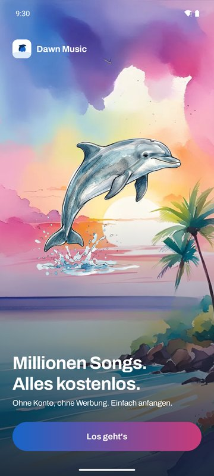<br><sub>Willkommen</sub></td>
<td align="center">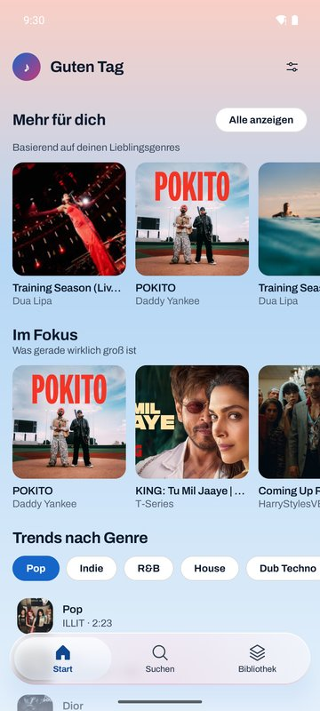<br><sub>Start</sub></td>
<td align="center">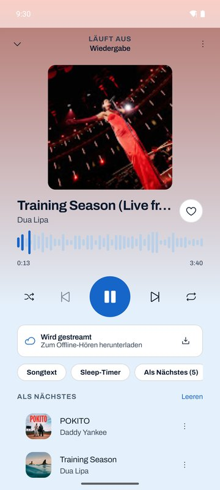<br><sub>Player</sub></td>
</tr>
<tr>
<td align="center">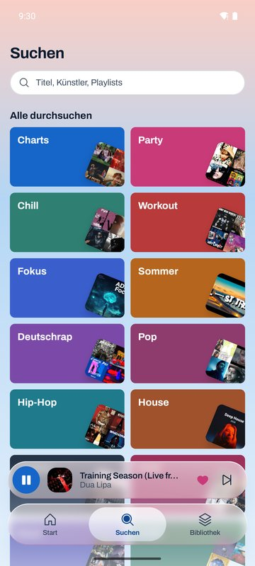<br><sub>Suchen</sub></td>
<td align="center">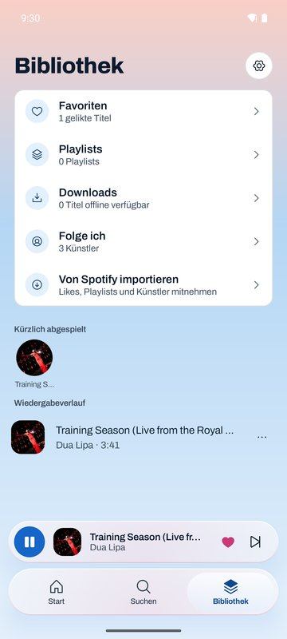<br><sub>Bibliothek</sub></td>
<td align="center">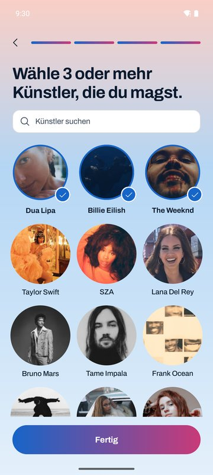<br><sub>Einrichtung</sub></td>
</tr>
</table>

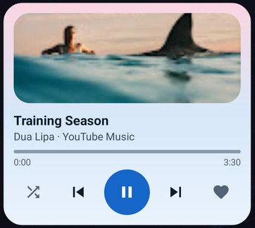<br><sub>Widget</sub>
</div>

## Architecture

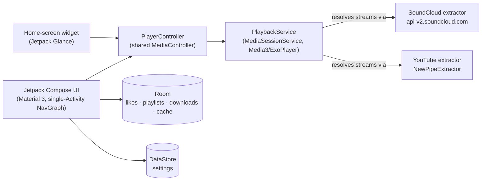

- **UI** — Jetpack Compose, Material 3, single-Activity navigation (`ui/navigation/NavGraph.kt`).
- **DI** — Hilt.
- **Playback** — Media3/ExoPlayer via a `MediaSessionService` (`playback/PlaybackService.kt`), controlled through one shared `MediaController` wrapper (`playback/PlayerController.kt`) that every screen — and the home-screen widget — plays through.
- **Extraction** (`data/extract/`):
  - `soundcloud/` — a hand-rolled OkHttp client against SoundCloud's undocumented `api-v2.soundcloud.com`, mirroring the approach yt-dlp's SoundCloud extractor uses (client_id rotation, transcoding resolution). Tracks served exclusively via DRM-encrypted HLS are detected and reported honestly as unplayable rather than silently failing (see `SoundCloudStreamResolver`).
  - `youtube/` — [NewPipeExtractor](https://github.com/TeamNewPipe/NewPipeExtractor) for search, artist channels, and stream resolution.
- **Local storage** — Room (`data/local/`) for the track cache, likes, playlists, and downloads; DataStore for settings.
- **Networking** — a plain OkHttp client for SoundCloud/YouTube extraction, kept deliberately separate from the optional backend-link client (see `data/extract/di/ExtractorModule.kt`) so no credentials ever leak to a third-party host.

## Desktop app

A desktop build for Linux and Windows with the same features (Compose Multiplatform, FFmpeg audio engine, parametric equalizer, MPRIS on Linux) lives in [`desktop/`](desktop). Releases ship the Android APK, a Windows installer, Linux packages and the source tarball. See [docs/DESKTOP.md](docs/DESKTOP.md).

## Building

Requires JDK 17 and the Android SDK (`compileSdk`/`targetSdk` 37, `minSdk` 30).

```sh
./gradlew :app:assembleDebug
```

The APKs land at `app/build/outputs/apk/grooveo/debug/` (full app) and `app/build/outputs/apk/dawn/debug/` (Dawn Music).

`local.properties` needs the usual `sdk.dir`; everything else has a working default (see [Optional backend link](#optional-backend-link) for the one optional section).

## Optional backend link

The app works completely standalone. If you also run the companion FastAPI backend (analytics + the update channel — not required for search, streaming, downloads, likes, or playlists), two things need configuring:

1. In-app **Settings**: set "Backend-URL" and "API-Key" to your backend's address and its `API_KEY`.
2. `local.properties` (create once, never committed):
   ```properties
   serviceAccountEmail=you@example.com
   serviceAccountPassword=your-password
   ```
   This is a real account on your backend (created via its own register/invite flow) used for a silent background login — the app never shows a login screen. Analytics events and the update check simply no-op if left blank.

## Privacy

Grooveo has no account, no analytics and no crash reporting, and it sends nothing
to its developers. The optional backend link is off unless you set a URL.

That does not make you invisible: music, podcasts and artwork are fetched straight
from third-party services (YouTube, SoundCloud, the ARD Audiothek, podcast hosts,
fyyd, image CDNs, GitHub for update checks, and Apple only if the fallback below is
on). Each of them sees your IP address and what you request, and may log it.

What the app does to keep that small (Einstellungen > Datenschutz):

- **Podcast search** goes to [fyyd](https://fyyd.de) first. Apple's directory is
  only asked when fyyd has no match, and that fallback can be switched off.
- **Tracking prefixes** (Podtrac, Chartable, Podscribe, OP3, Spotify's prefix and
  similar) are removed from episode URLs, so the audio is fetched from the host
  directly and the measurement service is skipped.
- **New-episode checks** can be switched off or limited to Wi-Fi.
- **"Hörtipps für dich"** (the personal podcast/Hörspiel/Hörbuch feed) is computed on the
  device from subscriptions and listening history. To suggest similar podcasts it
  asks fyyd about your two favourite feeds; that can be switched off.
- **History:** search history, music listening history and podcast progress stay on
  the device and can be deleted there (Einstellungen > Datenschutz > Verlauf löschen).
  Single entries can be removed too: "Aus Verlauf entfernen" in the library's
  history, and "Als gehört markieren" or "Aus Weiterhören entfernen" on a
  "Weiterhören" episode (long press on the start page).
- **YouTube as an audio source** is off by default (Einstellungen > Audio-Quellen).
  When switched on, Hörspiel/Hörbuch searches also ask YouTube, by default only
  for publishers' own channels, and the search's *Hörspiele & Hörbücher* tab adds
  series, channels and YouTube Music albums (each opens as a show, in order) and videos.
- **Proxy:** all app traffic can go through Tor (via Orbot) or your own SOCKS5
  proxy, with DNS resolved by the proxy. If the proxy is down, requests fail
  rather than falling back to a direct connection. The Spotify/Amazon import
  (a WebView) and update downloads (Android's download manager) do not use it,
  and YouTube often blocks Tor exit nodes.

## Known limitations

<details>
<summary>Some SoundCloud tracks are DRM-only</summary><br>

A subset of tracks (major-label content observed so far) are served exclusively through DRM-encrypted HLS with no working plain stream — the app detects this and reports it honestly instead of endlessly retrying; there's no DRM/Widevine license exchange implemented, and none is planned.
</details>

<details>
<summary>YouTube "Topic" channels sometimes expose no track list</summary><br>

Auto-generated channels for artists without a manually managed one occasionally expose neither a "Tracks" nor "Videos" tab through NewPipeExtractor's channel model; the app falls back to whatever tab is available, logging what it found for diagnosis if it still comes up empty.
</details>

<details>
<summary>YouTube Music has no real "charts" endpoint</summary><br>

Unlike SoundCloud's genuine trending API, nothing equivalent is reachable through NewPipeExtractor — the Home Charts shelf's YouTube half falls back to the general "Trending" kiosk, filtered by a rough song-length heuristic. Real data, just less precisely curated than the SoundCloud half.
</details>

<details>
<summary>Artist name resolution is best-effort</summary><br>

A track's "Zum Künstler" action only has an artist *name*, not an id, so it resolves via a 1-result search — usually right for well-known artists, not guaranteed on SoundCloud where duplicate-named accounts are common.
</details>

## Contributing

Contributions are welcome — see [`CONTRIBUTING.md`](CONTRIBUTING.md) for setup, code style, and the PR process, and [`docs/`](docs/) for a deeper architecture/development/release writeup. Please also read the [Code of Conduct](CODE_OF_CONDUCT.md).

## Security

Found a vulnerability? Please report it privately, not in a public issue —
see [`SECURITY.md`](SECURITY.md), which also has the security guidelines for
contributors.

## License

GPL-3.0-or-later — see [`LICENSE`](LICENSE). The desktop app also builds in [aubio](https://aubio.org) (GPL-3.0) and [Signalsmith Stretch](https://github.com/Signalsmith-Audio/signalsmith-stretch) / [Linear](https://github.com/Signalsmith-Audio/linear) (MIT). This is inherited from the [NewPipeExtractor](https://github.com/TeamNewPipe/NewPipeExtractor) (GPL-3.0-or-later) dependency used for YouTube Music extraction: distributing a build of this app is subject to GPL-3.0's copyleft terms.

<div align="right"><a href="#contents">back to top ↑</a></div>
